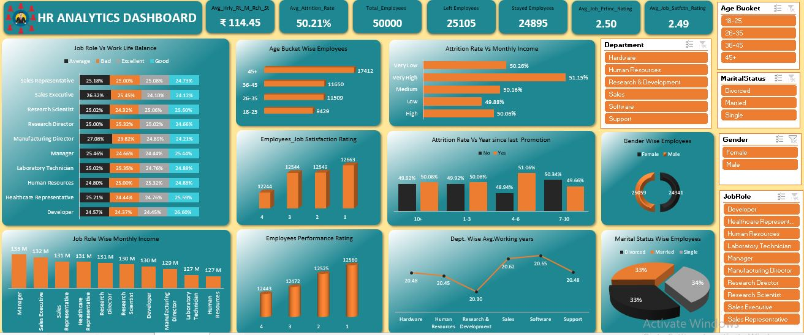

# HR Analytics Dashboard - Excel 


## 📌 Overview

This project is an **Excel-based interactive HR Analytics Dashboard** designed to provide a holistic view of workforce performance and employee attrition. It summarizes **employee demographics, attrition, job satisfaction, performance ratings, work-life balance, monthly income, promotion history, and department-wise experience**. Slicers allow quick exploration by Age Bucket, Marital Status, Gender, Job Role, and Department.
The dashboard uses **Power Pivot with DAX formulas** to calculate KPIs dynamically, making it fully responsive to slicer filters.

---

## 🌟 Key Features

* Comprehensive HR KPIs with real-time filtering
* Interactive slicers for **Age Bucket, Marital Status, Gender, Job Role, Department**
* Visual breakdown by **age bucket, gender, marital status, job role, and department**
* Attrition analysis by monthly income and years since last promotion
* Job satisfaction, performance rating and work-life balance insights
* Powered by **DAX** for accurate, dynamic calculations

---

## 📊 KPIs & Metrics Used

* **Total Employees:** 50,000
* **Left Employees:** 25,105
* **Stayed Employees:** 24,895
* **Average Attrition Rate:** 50.21%
* **Average Hourly Rate (Monthly Rate / Rich Status):** ₹114.45
* **Average Job Performance Rating:** 2.50
* **Average Job Satisfaction Rating:** 2.49

---

## 🧮 DAX Measures Used
<details> <summary><strong>🧮 View DAX Measures Used</strong></summary>
    
```
DAX

-- Total Employees
Total_Employees =
    COUNT(Employee[Employee ID])

-- Left Employees
Left Employees =
    CALCULATE(
        COUNT(Employee[Employee ID]),
        Employee[Attrition] = "Yes"
    )

-- Stayed Employees
Stayed Employees =
    CALCULATE(
        COUNT(Employee[Employee ID]),
        Employee[Attrition] = "No"
    )

-- Average Attrition Rate
Avg_Attrition_Rate =
    DIVIDE(
        CALCULATE(
            COUNT(Employee[Employee ID]),
            Employee[Attrition] = "Yes"
        ),
        COUNT(Employee[Employee ID])
    )

-- Average Hourly Rate
Avg_Hrly_Rt =
    AVERAGE(Employee[Hourly Rate])

-- Average Job Performance Rating
Avg_Job_Prfmc_Rating =
    AVERAGE(Employee[Performance Rating])

-- Average Job Satisfaction Rating
Avg_Job_Satisfctn_Rating =
    AVERAGE(Employee[Job Satisfaction])

-- Age Buckets
18-25 =
    CALCULATE(
        COUNT(Employee[Employee ID]),
        Employee[Age] >= 18 && Employee[Age] <= 25
    )

26-35 =
    CALCULATE(
        COUNT(Employee[Employee ID]),
        Employee[Age] > 25 && Employee[Age] <= 35
    )

36-45 =
    CALCULATE(
        COUNT(Employee[Employee ID]),
        Employee[Age] > 35 && Employee[Age] <= 45
    )

45+ =
    CALCULATE(
        COUNT(Employee[Employee ID]),
        Employee[Age] > 45
    )

-- Department Wise Average Working Years
Avg Working Years =
    AVERAGE(Employee[Total Working Years])

-- Job Role Wise Monthly Income
Total Monthly Income =
    SUM(Employee[Monthly Income])
```
</details>

## 📷 Dashboard Snapshot



> This interactive dashboard showcases HR performance insights with real-time filtering and drill-down capabilities.
---

## 📊 Visuals & What They Show

### 1) Job Role Vs Work Life Balance (100% Stacked Bar)

* **Categories:** Average, Bad, Excellent, Good
* **Job Roles:** Sales Representative, Sales Executive, Research Scientist, Research Director, Manufacturing Director, Manager, Laboratory Technician, Human Resources, Healthcare Representative, Developer
* **Highlights:** Manufacturing Director has the highest "Average" share (27.08%), Developer has the highest "Good" share (26.60%), Sales Executive has the highest "Average" share among sales roles (26.32%)
* Purpose: Understand how work-life balance perception differs across job roles.

### 2) Age Bucket Wise Employees (Horizontal Bars)

* **Age Bands & Counts:**
  18–25: 9429 · 26–35: 11509 · 36–45: 11650 · 45+: 17412
* Purpose: Understand workforce age distribution for succession planning and talent strategy.

### 3) Attrition Rate Vs Monthly Income (Horizontal Bars)

* **Income Levels & Attrition:**
  Very Low: 50.26% · Low: 49.88% · Medium: 50.16% · High: 50.06% · Very High: 51.15%
* Purpose: Check whether income level influences employees leaving the company.

### 4) Employees Job Satisfaction Rating (3D Column)

* **Ratings & Counts:**
  4: 12244 · 3: 12544 · 2: 12549 · 1: 12663
* Purpose: Measure overall employee satisfaction levels across the organization.

### 5) Attrition Rate Vs Years Since Last Promotion (Clustered Column)

* **Year Bands (No / Yes attrition):**
  10+: 49.92% / 50.08% · 1–3: 49.92% / 50.08% · 4–6: 48.94% / 51.06% · 7–10: 50.34% / 49.66%
* Purpose: Identify whether promotion gaps are linked to higher attrition.

### 6) Gender Wise Employees (Donut)

* **Counts (near-equal split):** Female 25059 · Male 24941
* Purpose: High-level demographic breakdown for diversity and inclusion planning.

### 7) Job Role Wise Monthly Income (Bar)

* **Top Roles:** Manager (133M), Sales Executive (132M), Sales Representative (131M), Healthcare Representative (131M), Research Director (131M)
* **Lower Roles:** Laboratory Technician (127M), Human Resources (127M)
* Purpose: Compare total monthly income spend across job roles for compensation planning.

### 8) Employees Performance Rating (3D Column)

* **Ratings & Counts:**
  4: 12443 · 3: 12472 · 2: 12525 · 1: 12560
* Purpose: Understand the distribution of performance ratings across the workforce.

### 9) Dept. Wise Avg. Working Years (Line)

* **Averages:** Hardware (20.48) · Human Resources (20.45) · Research & Development (20.30) · Sales (20.62) · Software (20.65) · Support (20.48)
* Purpose: Compare average employee experience across departments.

### 10) Marital Status Wise Employees (3D Pie)

* **Split:** Divorced (33%) · Married (33%) · Single (34%)
* Purpose: Understand workforce composition by marital status for benefits and policy planning.

### 11) Slicers (Right Panel)

* **Age Bucket, Marital Status, Gender, Job Role, Department**
* Purpose: One-click filters that update all visuals and KPIs for focused analysis.

---

## 📈 Key Insights (from the snapshot)

* **Balanced Attrition:** Attrition is almost evenly split — **50.21%** left (25,105) vs **49.79%** stayed (24,895) — indicating a serious retention challenge that needs attention.
* **Senior-Heavy Workforce:** The **45+** age group is the largest (**17,412** employees), highlighting the need for succession planning and knowledge transfer.
* **Income Impact:** Employees with **Very High** income show the highest attrition (**51.15%**), suggesting pay alone is not driving retention.
* **Promotion Gap:** Employees **4–6 years** since last promotion show the highest attrition (**51.06%**) — a good target for career-growth programs.
* **Satisfaction & Performance:** Average job satisfaction (**2.49**) and performance (**2.50**) ratings are mid-range, with ratings spread almost evenly across all levels.
* **Income Distribution:** **Manager** and **Sales Executive** roles lead in total monthly income (**133M** and **132M**), while **Laboratory Technician** and **Human Resources** are lowest (**127M**).

---

## 🛠 Tools & Technology Used

* **Microsoft Excel** – Data modeling, charts, slicers, Power Pivot
* **DAX** – Custom measures for KPIs & calculated fields
* **Pivot Tables/Charts** – Data aggregation & visual design

---

## 📂 Data Fields Used

* **Employee:** Employee ID, Age, Age Bucket, Gender, Marital Status
* **Job:** Job Role, Department, Monthly Income, Hourly Rate
* **Attrition:** Attrition (Yes/No), Years Since Last Promotion
* **Ratings:** Job Satisfaction, Performance Rating, Work Life Balance
* **Experience:** Total Working Years

---

## 🎨 Interactivity & Design

* Fully slicer-driven design for instant filtering
* KPI cards at the top for quick status overview
* Combination of **bar, column, donut, pie, line, and stacked charts** for diverse insights
* Teal and orange color theme for clarity and aesthetics

---

## 🏷 Tags

`Excel` `PowerPivot` `DAX` `Data Analysis` `HR Analytics` `Attrition Analysis` `Interactive Dashboard` `KPIs` `Data Visualization`

---

##  Author


**Syed Yaseen**  
*Aspiring Data Analyst | Power BI | Excel | SQL | Tableau*

<a href="https://syedyaseen324.carrd.co/">
  
</a>

⭐ **Don't forget to star the repo if you found it helpful!**
